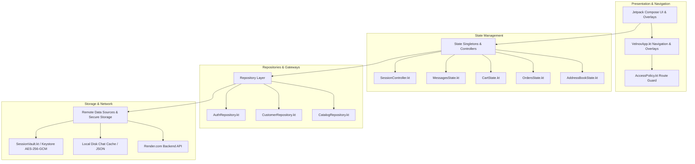
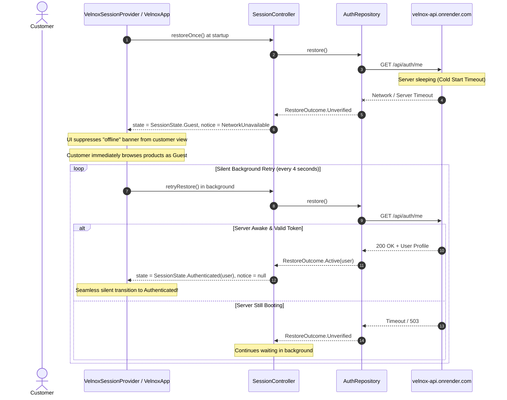

# Velnox Mobile — Master System Architecture & Subsystem Integration Guide

> **Target Audience:** AI Agents & Developers engineering Velnox Mobile.  
> **Purpose:** Comprehensive blueprint explaining how all subsystems interconnect, data flow contracts, cold-start lifecycles, and guidelines for maintaining system consistency across future AI tasks.

---

## 1. High-Level Architectural Blueprint

Velnox Mobile is an offline-resilient, production-ready Android e-commerce application built with **Modern Android Architecture (Clean Architecture + Jetpack Compose + MVI/Unidirectional Data Flow)**.



---

## 2. Core Subsystems & Connectivity Maps

### 2.1 Subsystem 1: Authentication, Session Lifecycle & Render.com Cold Starts

#### Components
- **`SessionVault.kt`**: Keystore-backed AES-256-GCM hardware storage (`filesDir/session/session.bin`). Excluded from Android Auto Backup.
- **`SessionManager.kt`**: In-memory token holder + `exp` JWT parsing.
- **`AuthRepository.kt`**: Resolves session validity via `/api/auth/me`.
- **`SessionController.kt`**: Central session state machine (`SessionState.Loading`, `Guest`, `Authenticated(user)`, `ExpiredSession`).

#### Render.com Cold Start Recovery & Silent Background Retry
The backend API (`https://velnox-api.onrender.com`) is hosted on Render.com free tier, which sleeps after inactivity. Cold boots require 30–50 seconds.



**Key Integration Rules:**
1. **Never show the `NetworkUnavailable` banner to customers at launch**: Handled automatically in `VelnoxApp.kt` by checking `activeNotice != SessionNotice.NetworkUnavailable`.
2. **Never drop the stored session on network timeout**: Token is preserved in `SessionVault` so background retry can restore authentication as soon as Render wakes up.

---

### 2.2 Subsystem 2: Customer Commerce Engine

#### Components
- **`CustomerRepository.kt`**: Authenticated gateway passing bearer token from `SessionManager.current()` to all customer operations. Catches 401 Unauthorized globally to trigger session expiry.
- **`CustomerRemoteDataSource.kt`**: Transports requests for Cart, Wishlist, Checkout, Shipping Quotes, Orders, Addresses, Conversations, and Messages.
- **`CartState.kt`**, **`WishlistState.kt`**, **`OrdersState.kt`**, **`AddressBookState.kt`**: Compose-observable state containers.

#### Request Authorization Pipeline
```
UI Action -> State Singleton -> CustomerRepository.call { api, token -> ... } -> CustomerRemoteDataSource -> Render API
                                          │ (if 401 Unauthorized)
                                          ▼
                               SessionController.onUnauthorized() -> SessionState.ExpiredSession
```

---

### 2.3 Subsystem 3: Real-Time Messaging & Instagram-Style Chat

#### Components
- **`MessagesState.kt`**: Conversation inbox, unread badges, thread caching, and live polling scheduler (`CHAT_POLL_INTERVAL_MS = 2500L`).
- **`ConversationScreen` (`MessagesScreen.kt`)**: Instagram Direct chat UI.
- **`CustomerRemoteDataSource.sortMessagesChronologically`**: Master sorting algorithm.

#### Two-Tier Message Persistence (Zero Disappearing Messages)
```mermaid
flowchart TD
    Open[User enters Chat Screen] --> CheckRAM{In-Memory Cache?}
    CheckRAM -- Yes --> RenderInstant[Render Messages Instantly (0ms)]
    CheckRAM -- No --> CheckDisk{Disk Cache msg_id.json?}
    CheckDisk -- Yes --> LoadDisk[Load from Disk & populate RAM] --> RenderInstant
    CheckDisk -- No --> Empty[Show initial loading spinner]
    
    RenderInstant --> FetchServer[Background Live Poll GET /messages]
    Empty --> FetchServer
    FetchServer --> Merge[MessagesState.mergePolledMessages]
    Merge --> UpdateRAM[Update RAM threadMessages]
    UpdateRAM --> SaveDisk[Atomic Disk Write msg_id.json.tmp -> .json]
    SaveDisk --> UIUpdate[UI smoothly updates new bubbles]
```

#### Instagram Direct UI & Chaining Rules
1. **Clustering (`< 60 seconds` by same sender)**:
   - Consecutive messages from the same sender within 60s are grouped into a cluster.
   - Spacing within cluster: `2.dp` (tight).
   - Spacing between different senders / new clusters: `8.dp` (generous).
2. **Adaptive Corner Radiuses**:
   - **Outgoing (Customer)**:
     - Solo: `(18.dp, 18.dp, 18.dp, 4.dp)`
     - Top of cluster: `(18.dp, 18.dp, 18.dp, 4.dp)`
     - Middle: `(18.dp, 4.dp, 18.dp, 4.dp)`
     - Bottom: `(18.dp, 4.dp, 18.dp, 18.dp)`
   - **Incoming (Seller/Support)**:
     - Solo: `(18.dp, 18.dp, 4.dp, 18.dp)`
     - Top of cluster: `(18.dp, 18.dp, 18.dp, 4.dp)`
     - Middle: `(4.dp, 18.dp, 18.dp, 4.dp)`
     - Bottom: `(4.dp, 18.dp, 18.dp, 18.dp)`
3. **Avatar Placement**:
   - For incoming messages, avatar is rendered **only at the bottom-most message of a cluster**. Upper messages preserve a `28.dp` blank spacer to maintain clean vertical alignment.
4. **Date / Time Separators**:
   - Displayed centered between message groups when time gap is `>= 15 minutes` or across calendar days (e.g. "วันนี้ 14:30", "เมื่อวาน 09:15").
5. **Strict Interleaving**:
   - `CustomerRemoteDataSource.sortMessagesChronologically` normalizes timestamps (seconds, millis, ISO-8601, MongoDB ObjectId hex timestamps) and ensures strict ascending order `[Incoming] -> [Outgoing] -> [Incoming]`.

---

### 2.4 Subsystem 4: Geolocation & Map Pin Picker

#### Components
- **`MapPinPickerDialog.kt`**: Interactive WebView hosting Leaflet + OpenStreetMap slippy tiles.
- **Dual-Layer Tile Engine**:
  - Street Layer: OpenStreetMap Standard Raster (`https://tile.openstreetmap.org/{z}/{x}/{y}.png`).
  - Satellite Layer: ESRI World Imagery High-Res Satellite (`https://server.arcgisonline.com/ArcGIS/rest/services/World_Imagery/...`).
- **GPS Integration**: Android `ACCESS_FINE_LOCATION` with high-accuracy GPS centering.
- **Reverse Geocoding**: Queries OpenStreetMap Nominatim reverse geocoder (`/reverse?format=json&lat=...&lon=...`).
- **Thai Administrative Parsing**:
  - Automatically extracts and maps:
    - `subdistrict` (ตำบล/แขวง)
    - `district` (อำเภอ/เขต)
    - `province` (จังหวัด)
    - `postalCode` (รหัสไปรษณีย์)
  - Auto-fills the `AddressInput` form on confirmation.

---

### 2.5 Subsystem 5: Navigation, Overlays & Access Control

#### Components
- **`VelnoxApp.kt`**: Root scaffold with 5-tab bottom navigation (`home`, `catalog`, `wishlist`, `orders`, `profile`).
- **Overlay Navigation System**:
  - Modal sheets and full-screen destinations:
    - `thread:{id}` -> `ConversationScreen`
    - `product:{id}` -> `ProductDetailScreen`
    - `order:{id}` -> `OrderDetailScreen`
    - `checkout` -> `CheckoutScreen`
    - `cart` -> `CartScreen`
    - `messages` -> `MessagesScreen`
    - `settings:{page}` -> `SettingsDetailScreen`
- **`AccessPolicy.kt`**:
  - Declarative policy guarding destinations requiring authentication (`orders`, `messages`, `checkout`, `profile`).
  - Unauthenticated attempts trigger the login modal with a `LoginReason`, capturing pending destinations so the user is returned seamlessly upon sign-in.

---

## 3. Critical Data Flow Matrix

| Source Subsystem | Destination Subsystem | Data Exchanged | Contract / Synchronization Mechanism |
|---|---|---|---|
| **Auth** (`SessionVault`) | **Customer** (`CustomerRepository`) | Bearer JWT Token | `token: suspend () -> sessions.current()` lambda passed in `VelnoxApplication` |
| **Auth** (`SessionController`) | **UI Shell** (`VelnoxApp`) | `SessionState` & `SessionNotice` | Compose state; background retry elevates `Guest` to `Authenticated` silently |
| **Map Picker** (`MapPinPickerDialog`) | **Address Book** (`AddressBookState`) | Lat/Lng + Geocoded Thai Address | Callback returns `LocationResult`, auto-populates `AddressInput` |
| **Address Book** (`AddressBookState`) | **Checkout** (`CheckoutScreen`) | `Address` (Default or Selected) | `shippingAddressId` passed to `shippingQuote` & `checkout` API |
| **Catalog** (`ProductDetailScreen`) | **Messages** (`ConversationScreen`) | `productId` & `productName` | Inquiries trigger `MessagesState.openShopConversation(shopId, productId)`, pinning product card in chat |
| **Messaging** (`ConversationScreen`) | **Disk Storage** (`chat_cache/`) | List of `CustomerMessage` | Two-tier caching: in-memory `threadMessages` + atomic `.tmp` rename to `msg_{id}.json` |

---

## 4. Instructions for Future AI Agents

When implementing new features or bugfixes in Velnox Mobile:

1. **Local PocketDev Build Rule**:
   - Always build using the authorized command from `AGENTS.md`:
     ```bash
     timeout 5m gradle -Dorg.gradle.jvmargs= --no-daemon --max-workers=2 --offline --init-script /root/.gradle/init.d/pocketdev-android.gradle -Pandroid.aapt2FromMavenOverride=/root/android-sdk/build-tools/35.0.0/aapt2 assembleDebug --console=plain --stacktrace
     ```
   - Never run plain `gradle build` or start background daemons.
2. **Mandatory Git Push Rule**:
   - Commit changes with descriptive Conventional Commits (`feat(...)`, `fix(...)`) and immediately push to `origin/main`.
3. **Session & Cold Start Safety**:
   - Never surface network failure notices to customers during launch cold-starts. Let `retryRestore()` handle server wake-up silently.
4. **Chat & Cache Integrity**:
   - Never remove local disk caching for chat messages. Any change to `ConversationScreen` or `MessagesState` must preserve immediate `initialCached` loading.
5. **State Singletons**:
   - Do not create competing state holders. Mutate existing singletons (`MessagesState`, `CartState`, `OrdersState`) so Compose recomposition triggers throughout the app predictably.
