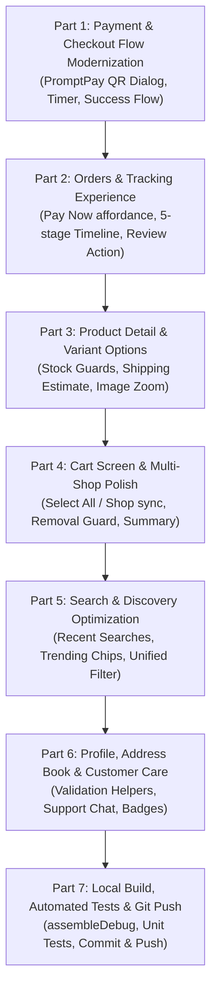

# แผนการพัฒนาและปรับปรุงระบบ Velnox Mobile E-Commerce สู่มาตรฐานระดับสากล (Master Architecture Plan)

> **เอกสารอ้างอิงและแผนยุทธศาสตร์ทางเทคนิค (Master Plan)**  
> จัดทำขึ้นเพื่อปรับแต่งและยกระดับแอปพลิเคชัน **Velnox Mobile (Android Compose)** ให้ทำงานสอดคล้องอย่างสมบูรณ์แบบกับเว็บไซต์หลัก (`velnox-marketplace`), Cloudflare Workers API, Neon PostgreSQL Database, และ Cloudflare R2 CDN ตามหลักการออกแบบและพัฒนาแพลตฟอร์ม E-Commerce ระดับพรีเมียม (Velnox Design System v2.2)

---

## 1. การวิเคราะห์ภาพรวมและจุดที่ต้องปรับปรุง (Comprehensive Audit & Gaps Analysis)

จากการวิเคราะห์เปรียบเทียบสถาปัตยกรรมของเว็บไซต์หลัก (`apps/velshop`) และระบบแอปพลิเคชันมือถือ Android ในปัจจุบัน พบข้อสังเกตและจุดที่ควรปรับปรุงเพื่อให้เป็นไปตามมาตรฐาน E-Commerce ที่ดีที่สุดดังนี้:

### 1.1 ระบบชำระเงินและ Checkout (Payment & Checkout Experience)
- **จุดที่ขาดหาย:** เมื่อผู้ใช้เลือกชำระเงินผ่าน **PromptPay (QR Code)** ในหน้า [CheckoutScreen.kt](file:///workspace/clever-bose/app/src/main/java/com/velnox/app/feature/checkout/CheckoutScreen.kt) ระบบเดิมแสดงเพียงกล่องข้อความ Alert Dialog ธรรมดาโดยไม่มีหน้าแสดง QR Code หรือตัวนับเวลาถอยหลัง (Expiration Countdown Timer)
- **สิ่งที่ต้องเพิ่ม:** หน้าจอ/Dialog แสดง **PromptPay QR Code Generator & Viewer** พร้อมปุ่มบันทึกรูป QR Code, ตัวเลขอ้างอิง (Reference No.), บัญชีปลายทาง ("Velnox Marketplace"), จำนวนเงินที่ต้องชำระ และปุ่มตรวจสอบสถานะการชำระเงินแบบเรียลไทม์ (Payment Status Verification)

### 1.2 หน้ารายละเอียดคำสั่งซื้อและการติดตามสถานะ (Orders & Tracking Detail)
- **จุดที่ต้องปรับปรุง:** ใน [OrdersScreen.kt](file:///workspace/clever-bose/app/src/main/java/com/velnox/app/feature/orders/OrdersScreen.kt) เมื่อคำสั่งซื้ออยู่ในสถานะ `Pending / To Pay` ผู้ใช้ยังไม่มีปุ่มด่วนสำหรับ "ชำระเงินตอนนี้ (Pay Now)" หรือ "ดู QR Code ชำระเงิน"
- **สิ่งที่ต้องเพิ่ม:** 
  - ปุ่ม **"Pay Now / View QR Code"** สำหรับออเดอร์ที่ค้างชำระ
  - การปรับปรุง **Order Timeline Tracking** ให้มี 5 ขั้นตอนชัดเจน: `สั่งซื้อแล้ว (Placed) -> ชำระเงินแล้ว (Paid) -> กำลังจัดเตรียม (Processing) -> อยู่ระหว่างขนส่ง (Shipped) -> จัดส่งสำเร็จ (Completed)`
  - ปุ่ม **"Review Item"** สำหรับคำสั่งซื้อที่สำเร็จแล้ว เพื่อให้ลูกค้าสามารถรีวิวและให้คะแนนสินค้าได้

### 1.3 หน้ารายละเอียดสินค้าและตัวเลือกสินค้า (PDP & Variant Options)
- **จุดที่ต้องปรับปรุง:** 
  - การจำกัดจำนวนสินค้าที่สั่งซื้อ (Quantity Stepper Cap) ให้สัมพันธ์กับสต็อกคงเหลือของ Variant ที่เลือกอย่างเคร่งครัด
  - การแสดงข้อมูลการจัดส่งเบื้องต้น (Shipping Estimate Snippet) เช่น "ส่งมาตรฐาน 2-4 วันทำการ • จัดส่งรวดเร็ว" ใต้ราคาสินค้า เพื่อเพิ่มความมั่นใจในการสั่งซื้อ
  - การปรับปรุงระบบ Full-screen Image Viewer ให้มีระบบ Pinch-to-zoom และ Reset แบบนุ่มนวล

### 1.4 หน้าตะกร้าสินค้า (Cart & Multi-Shop Grouping)
- **จุดที่ต้องปรับปรุง:**
  - เพิ่มความลื่นไหลของระบบ "เลือกทั้งหมด (Select All)" และ "เลือกทั้งร้านค้า (Select Shop)" โดยให้ Synchronize กับสถานะของไอเทมแต่ละรายการอย่างแม่นยำ
  - มี Dialog ยืนยันการลบสินค้าออกจากตะกร้าเพื่อป้องกันผู้ใช้เผลอกดลบโดยไม่ตั้งใจ
  - แสดงสถานะสินค้าหมดสต็อก (Out of Stock) แบบ Grayed-out ในตะกร้า พร้อมปุ่มลบด่วน

### 1.5 ระบบค้นหาและตัวกรองตลาด (Search & Discovery)
- **สิ่งที่ต้องปรับปรุง:**
  - เพิ่มการจัดเก็บ **Recent Search History** (ประวัติการค้นหาล่าสุด) และปุ่ม "ล้างประวัติ"
  - เพิ่ม **Trending / Popular Suggestions** (คำค้นหายอดนิยม)
  - ปรับปรุง Search Filter Sheet ให้กรองช่วงราคา (Min/Max Price), สถานะมีสินค้าในสต็อก, และการเรียงลำดับ (ราคาต่ำ-สูง, ราคาสูง-ต่ำ, สินค้ามาใหม่, ยอดนิยม) อย่างลื่นไหล

### 1.6 หน้าโปรไฟล์ บันทึกที่อยู่ และบริการช่วยเหลือ (Profile, Address Book & Support)
- **สิ่งที่ต้องปรับปรุง:**
  - ปรับปรุงการตรวจสอบความถูกต้องของฟอร์มที่อยู่ (เบอร์โทรศัพท์ไทย 10 หลัก, รหัสไปรษณีย์ไทย 5 หลัก)
  - เพิ่มทางลัดเปิดแชทกับทีมงานซัพพอร์ต (`startSupportConversation`) โดยตรงจากหน้าช่วยเหลือ
  - แสดงจำนวนสินค้าใน Wishlist บน Badge หน้า Profile

---

## 2. ขั้นตอนการดำเนินงานทีละพาร์ท (Phased Implementation Roadmap)

---

### รายละเอียดในแต่ละพาร์ท (Task Breakdown)

### **Part 1: Payment & Checkout Flow Modernization**
1. สร้างคอมโพเนนต์ `PromptPayQrSheet` / `PromptPayQrDialog` ใน `feature/checkout/` แสดง:
   - โลโก้/สัญลักษณ์ PromptPay พร้อมตรากำกับทางการ
   - ยอดเงินสุทธิที่ต้องชำระ (เช่น ฿144.53)
   - หมายเลขคำสั่งซื้อและบัญชีรับชำระเงิน
   - โค้ด QR Code จำลอง/แสดงผลแบบ Vector/Graphic ที่คมชัด
   - ตัวนับเวลาถอยหลัง (15 นาที) และปุ่ม "ฉันได้ชำระเงินแล้ว / ตรวจสอบสถานะ"
2. ปรับปรุง `CheckoutScreen.kt` ให้เชื่อมต่อกับการแสดงผล PromptPay Dialog อัตโนมัติเมื่อเลือกชำระด้วย PromptPay
3. ปรับปรุงหน้าจอสำเร็จ (Checkout Success) ให้แสดงปุ่ม "ดูคำสั่งซื้อ (View Order)" และ "ช้อปปิ้งต่อ (Continue Shopping)"

### **Part 2: Orders & Tracking Experience**
1. ปรับปรุง `OrdersScreen.kt`:
   - ในการ์ดคำสั่งซื้อที่ค้างชำระ (`Pending / Unpaid`) ให้เพิ่มปุ่ม "ชำระเงินทันที (Pay Now)" นำไปยังหน้าชำระเงิน/เปิด PromptPay QR Code ได้ทันที
   - อัปเกรด `OrderTimeline` ให้แสดง 5 หมุดสถานะมาตรฐานสากล: `Placed -> Paid -> Processing -> Shipped -> Completed`
   - เพิ่มปุ่ม "เขียนรีวิวสินค้า (Review)" เมื่อสถานะคำสั่งซื้อเป็น `Completed`
2. ปรับปรุงการนำทางและ Interaction ในการกดคัดลอกเลขพัสดุ (Tracking Number) พร้อม Visual Feedback

### **Part 3: Product Detail (PDP) & Variant Options**
1. ปรับปรุง `ProductOptionsBottomSheet.kt` และ `ProductDetailScreen.kt`:
   - เพิ่มการตรวจสอบสต็อกสูงสุดของ Variant หากสินค้าเหลือ 0 ชิ้น ให้แสดง Badge "สินค้าหมด" และปิดการกดสั่งซื้อ
   - เพิ่มบล็อกข้อมูลการจัดส่งเบื้องต้น (Shipping Estimate): "จัดส่งภายใน 2-4 วันทำการ • มีบริการเก็บเงินปลายทาง"
   - ปรับปรุงการแสดงผลส่วนคะแนนรีวิว (Ratings breakdown) ให้มีกราฟิกแท่งแสดงความพึงพอใจ 5 ระดับชัดเจน

### **Part 4: Cart Screen & Multi-Shop Polish**
1. ปรับปรุง `CartScreen.kt` และ `CartState.kt`:
   - ระบบ Checkbox: ตรวจสอบความถูกต้องของการติ๊กเลือกระหว่าง "Select All", "Select Shop" และ "Single Item" ให้สอดคล้องกัน 100%
   - เพิ่ม Dialog ยืนยันการลบสินค้าเมื่อผู้ใช้กดยกเลิกรายการ
   - ปรับแต่ง Checkout Bar ด้านล่างให้แสดงยอดรวมและจำนวนรายการที่เลือกอย่างแม่นยำ

### **Part 5: Search & Discovery Optimization**
1. ปรับปรุง `SearchScreen.kt`:
   - เพิ่มการบันทึกประวัติการค้นหาล่าสุด (Recent Searches) ลงใน SharedPreferences/DataStore
   - เพิ่ม Chip หมวดหมู่ค้นหายอดนิยม (Popular Searches)
   - ปรับปรุง Modal Bottom Sheet ของตัวกรองให้รองรับ Slider/TextField สำหรับช่วงราคาต่ำสุด-สูงสุด

### **Part 6: Profile, Address Book & Support**
1. ปรับปรุง `AddressModels.kt` / `ProfileScreen.kt`:
   - ฟังก์ชันตรวจสอบเบอร์โทรศัพท์ (10 หลักขึ้นต้นด้วย 0) และรหัสไปรษณีย์ไทย (5 หลัก)
   - ปรับปรุงปุ่ม "ติดต่อฝ่ายบริการลูกค้า (Customer Support)" ให้เรียก `startSupportConversation` โดยตรง
   - เพิ่ม Badge ตัวเลขแสดงจำนวนสินค้าใน Wishlist

### **Part 7: Local Build, Automated Tests & Mandatory Git Push**
1. ดำเนินการรัน Local Unit Tests ทั้งหมดเพื่อทดสอบความถูกต้อง
2. รัน Local Android Fast-Path Build (`assembleDebug`) ตามข้อกำหนดของ PocketDev
3. ตรวจสอบไฟล์ APK ที่ได้ (`app-debug.apk`)
4. Stage, Commit และ Push ขึ้น GitHub (`origin/main`) ตามนโยบาย `AGENTS.md`
